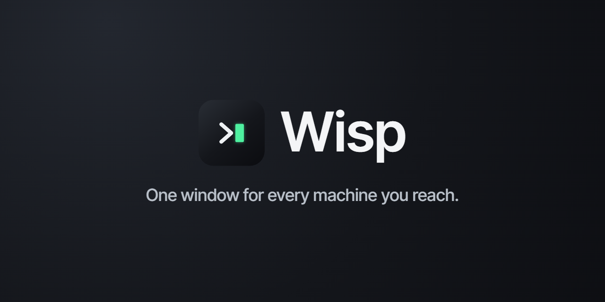

i am not a bot, i am a human being, i also kind of suck at rust so if you want to contribute, please be patient with me <3

# Wisp

A small, secure SSH/SFTP/VNC/RDP desktop client built with Tauri v2 and React.

Features:

- SSH terminal sessions (xterm.js) with tabs and split panes
- VNC remote desktop with VNC passwords, macOS Screen Sharing logins, and VeNCrypt (X.509)
- RDP remote desktop for Windows (NLA) and xrdp, with clipboard text, sound, a shared local folder, and RD Gateway
- Saved profiles and groups, custom icons, and `~/.ssh/config` + PuTTY `.ppk` import
- Encrypted profile export and import, with a field-by-field review when a profile already exists
- SFTP file browser with uploads and downloads
- Local, remote, and dynamic (SOCKS) port forwarding, plus jump hosts
- Trust-on-first-use for SSH host keys and remote desktop certificates, encrypted secret vault, and themeable appearance

## Develop

```sh
bun install
bun run tauri dev
```

## Test

```sh
bun run test:run                                   # frontend (vitest)
cargo test --manifest-path src-tauri/Cargo.toml    # backend (Rust)
```

`bun run lint` runs Biome over `src`. The Rust IPC layer generates `src/bindings.ts`;
regenerate it with `cargo test --manifest-path src-tauri/Cargo.toml export_bindings`.
